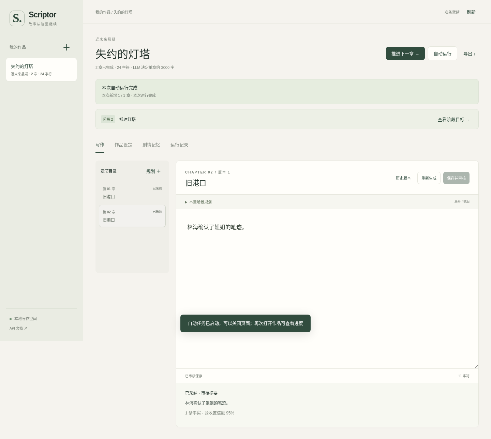

# Scriptor

**你给点子、要点和行文风格，LLM 决定故事的其余部分。**

书名、题材、主角、配角、反派、地图、冲突、成长体系、升级策略、分卷和阶段安排，都由 LLM 自主构思。用户可以逐章手动推进，也可以开启后台自动运行；无需提前填写阶段目标或验收条件。

所有模型调用使用 **Responses API**。网页、CLI 和 HTTP API 共用同一写作核心，SQLite 保存创作方案、正文、证据记忆、版本历史和自动任务进度。

## 界面预览




## 安装与配置

Python 3.10+：

```bash
python3 -m venv .venv
source .venv/bin/activate
python -m pip install -e '.[dev]'
cp .env.example .env
```

填写 `.env`：

```dotenv
OPENAI_API_KEY=你的密钥
OPENAI_BASE_URL=https://api.openai.com/v1
OPENAI_MODEL=你有权限使用且支持Responses的模型
```

也可通过 `uv sync --locked --extra dev` 安装锁定依赖。环境变量优先于 `.env`。

| 变量 | 默认值 | 说明 |
| --- | --- | --- |
| `OPENAI_API_KEY` | 空 | 生成时必填；保存点子和读取作品不需要 |
| `OPENAI_MODEL` | 空 | 显式选择可用模型，不绑定厂商 |
| `OPENAI_BASE_URL` | `https://api.openai.com/v1` | API 根路径，不追加 `/responses` |
| `SCRIPTOR_DB` | `data/scriptor.db` | SQLite 数据库 |
| `SCRIPTOR_TIMEOUT` | `180` | 单次请求超时秒数；SDK 最多重试两次 |
| `SCRIPTOR_MAX_OUTPUT_TOKENS` | `12000` | 单次输出 token 上限 |
| `SCRIPTOR_STRUCTURED_OUTPUT` | `true` | 严格 JSON Schema；设为 `false` 时仍使用 Responses，仅本地校验 JSON |
| `SCRIPTOR_CONTEXT_CHARS` | `28000` | 上下文字符预算，不是 token 数；审核包含完整正文 |

第三方服务必须实现 `POST /responses`。仅兼容 Chat Completions 不足以使用本项目，不会自动回退到其他 API。

## 网页使用

```bash
scriptor serve --port 8000
```

默认监听 `0.0.0.0`。本机访问 **http://127.0.0.1:8000/**，其他设备使用 `http://服务器IP:8000/`。可用 `--host 127.0.0.1` 改为本机监听。页面随 Python 包安装，不需要前端构建或 CDN。

### 1. 提供创作种子

点击「开始一部新作品」，只需填写：

- **点子**：零散想法、世界概念、人物处境或故事开端。
- **要点**：希望保留的设定、桥段、偏好或禁区，可选，每行一条。
- **行文风格**：节奏、语言、视角、对话与描写偏好。

保存时不会调用模型。人物、地图、阶段目标等不需要用户补全。

### 2. 选择运行方式

| 方式 | 行为 |
| --- | --- |
| **推进下一章** | 缺少方案则先构思，缺少规划则先规划；当前阶段完成后由 LLM 决定下一阶段或完结，然后生成并审核下一章 |
| **自动运行** | 后台重复相同流程，自动处理阶段切换，直到本次章数上限、LLM 判定故事完结、用户暂停或发生失败 |
| **暂停运行** | 等待当前模型调用结束，在下一处理阶段前停止；保留已采纳正文和已有候选 |

自动运行的「最多新增章节」是本次任务的停止条件，默认 10 章，可设 1–500 章；它不是全书长度要求。关闭网页不影响服务器中的任务，重新打开作品即可查看进度。服务器停机不会自动重启付费生成；重新启动服务后，可再次运行以继续已有作品。

### 3. 查看或干预创作

- **作品设定**：查看 LLM 决定的人物关系与成长、地图与解锁、各体系等级与规则、升级代价和限制、整体升级与叙事策略、分卷和结局方向。
- **阶段面板**：查看阶段目标、人物与体系发展策略、舞台、后续承接和正文验收证据。无需填写下一阶段，继续推进时 LLM 会作出决定。
- **写作区**：查看场景安排、阅读正文，也可编辑当前阶段最新一章并重新审核。高级规划和单章生成入口仍保留。
- **剧情记忆**：查看由已采纳正文抽取的人物状态、事件和伏笔。
- **运行记录**：查看失败原因与候选，下载或重新载入编辑器。
- **历史与导出**：保留已采纳版本，导出完整 Markdown 正文。

未保存正文暂存当前浏览器，切换或离开有提醒。自动任务运行期间，该作品的手动修改会被锁定；需要干预时先暂停。浏览器草稿不是服务器备份。

## LLM 如何组织创作

```text
点子 + 要点 + 行文风格
           ↓
自主构思：人物 / 地图 / 冲突 / 体系 / 升级策略 / 分卷 / 结局方向
           ↓
自主制定阶段目标、发展策略与正文验收条件
           ↓
近程规划 → 逐章叙事导演 → 主笔 → 文学审稿 / 定向修订
                                      ↓
                             事实审核 → 证据记忆与叙事接力
           ↑                                  ↓
           └──── 未完成阶段：继续推进 ──────────┤
                                              ↓
                         阶段完成：LLM 决定下一阶段或完结
```

LLM 制定验收项，也必须根据正文证据判断是否完成。规划不算已发生事实。写章分为几个可追踪的阶段：

1. **叙事导演**读取前章正文、人物当前欲望和未完后果，安排本章的起因、阻力、选择、代价与实际回报。可重排尚未发生的弱规划，不能推翻已发生事实和世界硬规则。
2. **主笔**写完整场景。专业背景要通过解决问题体现，对话要有人物利益，避免连续几章只问话、记录、申请许可。
3. **独立文学审稿**检查因果、人物动机、场景进展和用户风格。重大问题和客观连续性矛盾必须定位到正文片段并修复；需要时带着完整原稿定向修订，最多两轮。失败后保留候选和意见，不反复重启写作。
4. **事实审核**从完整正文选择片段编号；程序提取真实引用并检查验收编号。结构与引用错误在同一稿上最多重审两次，实质矛盾才进入有限的内容修订。
5. **叙事接力**保存本章真正发生的因果链、人物所知与欲望、关系变化、未完后果及已兑现承诺。下一章同时获得这些状态、前章正文和检索事实，避免只靠简短摘要接写。
6. 通过全部检查后，正文、实际场景规划、文学审稿、记忆与版本历史一起提交。手动编辑时只给审核意见，不偷偷替用户改写。

正常单章需要导演、主笔、文学审稿、事实审核四次模型调用，构思、规划和修订另计，耗时与 token 开销高于旧版。网页运行记录可查看导演方案、保留稿数和具体审稿意见；模型评分用于辅助检查，不是客观质量保证。

审核接口异常、证据修复失败或暂停后，只有创作指纹一致的候选才自动复用；指纹包含流程版本，旧流程候选不会被直接沿用。旧正文、历史与旧审核仍可读取，已有章节不会自动覆盖。

所有修复都有次数上限，网络故障不会无限重试。失败时已有正文不变，候选和审核过程保存在运行记录。片段编号与引用的存在性由程序保证；编号是否支持事实含义仍需模型判断。

原文引文检查不能证明语义判断一定正确，置信度也是模型自评。系统提供可追踪的创作流程，不承诺模型的文学质量或永不出现设定遗漏。

## 命令行

`examples/book.json` 只包含点子、要点和风格：

```bash
scriptor create --input examples/book.json
scriptor list

# 每次手动推进到下一章，无需手工规划或设置目标
scriptor step BOOK_ID
scriptor step BOOK_ID

# 自动新增最多 10 章；达到结局会提前结束
scriptor auto BOOK_ID --chapters 10
# Ctrl+C 请求暂停，并等待当前步骤完成；以后重跑即可继续

scriptor show BOOK_ID
scriptor runs BOOK_ID
scriptor export BOOK_ID --output novel.md
```

也可通过 `scriptor conceive BOOK_ID` 单独构思全部方案。`plan`、`write`、`edit`、`history` 等高级命令仍然可用；旧 `{book,stage}` 建书格式和已有数据库继续兼容，但不是新版默认创作入口。

## HTTP API

交互文档：`/docs`。

| 方法与路径 | 用途 |
| --- | --- |
| `POST /api/books` | `{"ideas":"点子","points":["要点"],"style":"行文风格"}` |
| `GET /api/books` / `GET /api/books/{id}` | 书架 / 方案、正文、阶段与记忆 |
| `POST /api/books/{id}/step` | 手动推进下一章，无需请求体 |
| `POST /api/books/{id}/conceive` | 单独构思全部方案 |
| `POST /api/books/{id}/direct` | 阶段验收后由 LLM 决定后续或完结 |
| `POST /api/books/{id}/auto` | `{"chapters":10}`，返回 202 和后台任务 |
| `GET /api/books/{id}/auto` | 自动任务状态、步骤和新增章节进度 |
| `POST /api/books/{id}/auto/{job_id}/pause` | 请求暂停 |
| `GET /api/books/{id}/runs` | 模型调用及候选记录 |
| `GET /api/books/{id}/export` | Markdown 正文 |

高级的设定、规划、单章生成、正文编辑、版本历史及人工阶段接口继续保留。所有入口共用事务与版本检查。

## 开发与验证

```bash
ruff check .
ruff format --check .
pytest -q

# 可选：真实浏览器烟测，使用临时库和假模型
uv run --extra dev --with playwright python -m playwright install chromium --only-shell
uv run --extra dev --with playwright python -m tests.browser_editor
```

测试覆盖自主构思、跨阶段推进、收束、修订上限、后台暂停与续跑、任务租约、旧库升级、事务、版本与 Responses 协议。浏览器烟测覆盖三字段建书、手动推进、自动运行和编辑恢复。离线测试不使用真实密钥；真实模型的小样本阅读验证与局限见 [叙事流程验证](docs/narrative-evaluation.md)。

0.4.1 还在隔离数据库副本上使用本机配置的真实模型，重新审核失败候选并连续自动新增 2 章；该目标作品的 25 条事实与验收引用均通过原文校验。复现原因、修复流程及验证边界见 [自动运行修复验证](docs/validation.md)。

详细设计见 [架构说明](docs/architecture.md)，早期参考方案见 [调研与取舍](docs/research.md)。应用仍按单机单用户工具运行，没有多用户鉴权、语义向量库或任意历史章节依赖重写。数据库、密钥和本地书籍不进入 Git。

MIT License，见 [LICENSE](LICENSE)。
